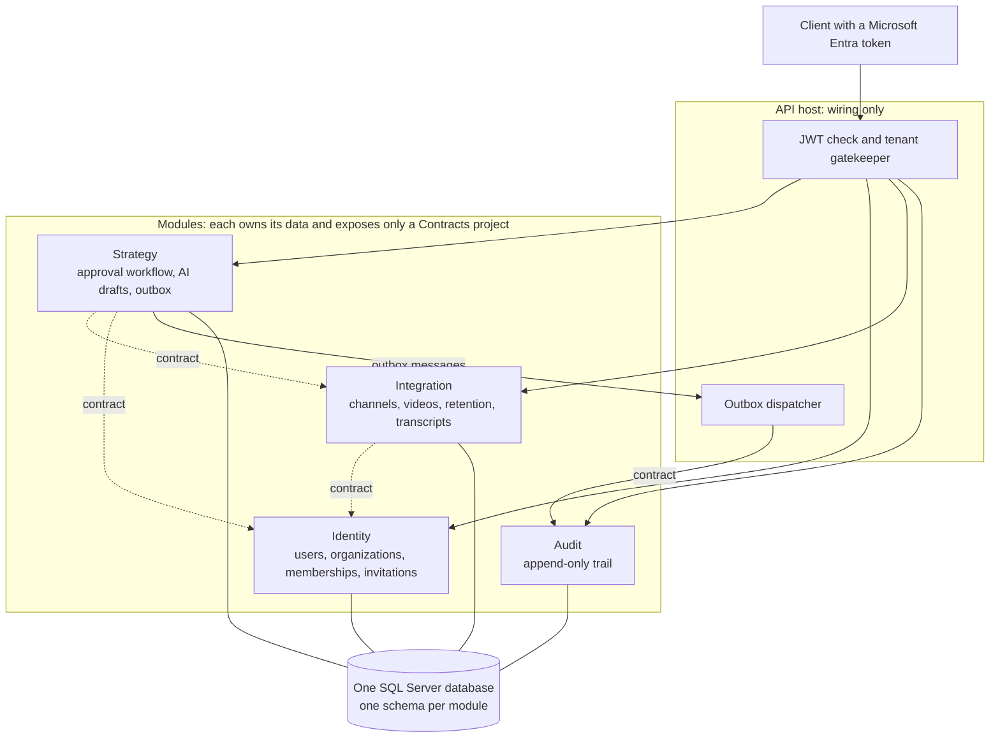
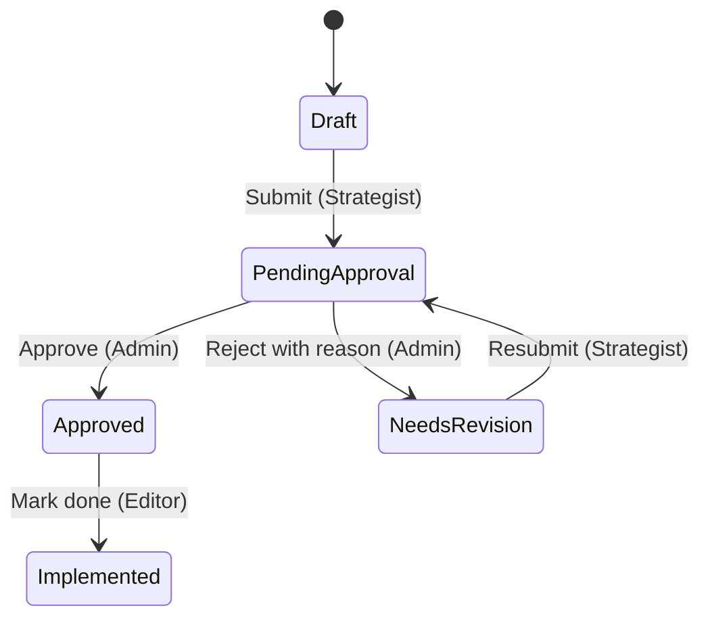
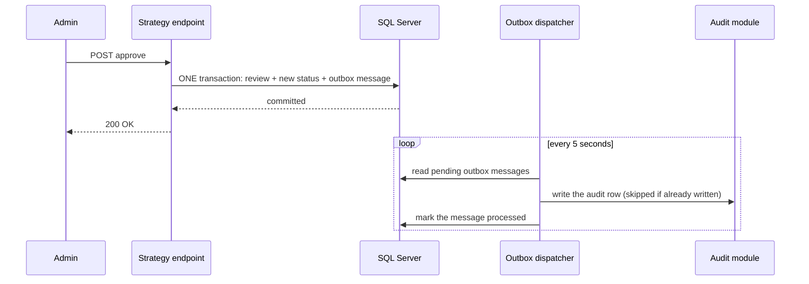
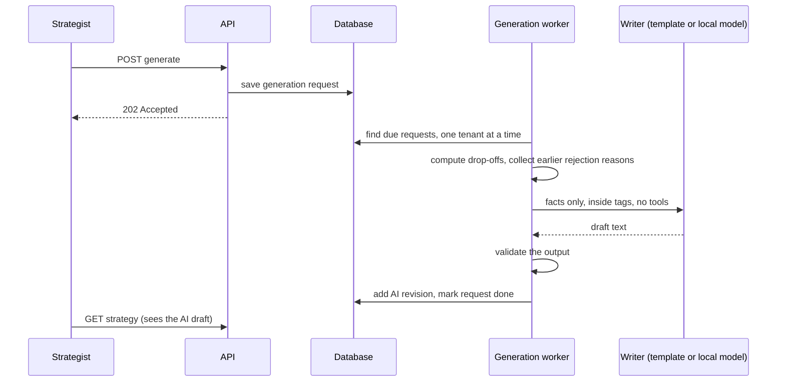
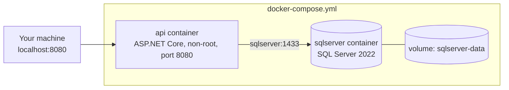
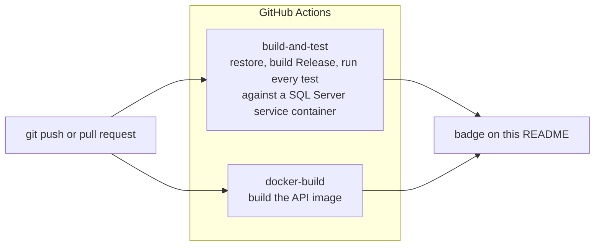

# CreatorAnalytics

[](https://github.com/shawaiz12/Creator_Analysis_App/actions/workflows/ci.yml)

> A multi-tenant SaaS backend for YouTube channel teams. It ingests video performance
> data, turns it into AI-assisted strategy drafts, and guarantees that **no AI output is
> used until a human has approved it**.

Built with .NET 10, ASP.NET Core, EF Core and SQL Server. It runs with one command in
Docker, builds and tests itself in GitHub Actions, and every major decision is written down
as an Architecture Decision Record.

---

## What it does

- A team (an **organization**) connects a YouTube channel. The system pulls the channel's
  videos, transcripts and **audience-retention curves** (100 data points per video).
- A **Strategist** asks for an AI draft. The system computes the drop-off facts itself,
  hands only those facts to a writer (a deterministic template, or a local language model),
  and stores the result as a draft revision.
- The Strategist edits and submits it. An **Admin** approves, or rejects with a mandatory
  reason. An **Editor** sees only approved strategies and marks them implemented.
- Every step is written to an append-only **audit trail**.

| Role | Can do |
| --- | --- |
| **Admin** | Everything in their organization: connect channels, invite people, approve or reject, read the audit trail |
| **Strategist** | Sync channels, read videos and retention, add transcripts, request AI drafts, edit and submit strategies |
| **Editor** | Read approved strategies and mark them implemented. Nothing else |

One person can belong to several organizations with a different role in each.

---

## What to look at first

| If you care about... | Look at | Proof |
| --- | --- | --- |
| **Architecture** | [Modular monolith](#architecture): four modules that may only talk through small Contracts projects | Three architecture tests fail the build on a violation |
| **Data safety** | [Tenant isolation](#multi-tenancy) in three layers, failing closed | Cross-tenant tests at the database and HTTP level |
| **Reliability** | [Transactional outbox](#the-transactional-outbox) for the audit trail | Tests for crash-retry, duplicates, two tenants, poison messages |
| **AI done carefully** | [Facts first, untrusted input, validated output](#ai-draft-generation) | Prompt-injection and failure-classification tests, no real model needed |
| **Delivery** | [Docker](#docker) and [CI](#ci) | `docker compose up`, a green pipeline on every push |
| **Judgement** | [Decision records](#decisions-and-scope) and an honest list of limits | `docs/adr` |

---

## Architecture

One deployable application, split into **four modules** that each own their data. They
share one SQL Server database, but each lives in its own schema.



The rules, and how the build enforces them (`tests/CreatorAnalytics.ArchitectureTests`):

- A module may use another module's **Contracts** project, never its implementation
  (`ModuleBoundaryTests`).
- The API host may not touch any module's `Domain` or `Infrastructure` types
  (`HostBoundaryTests`).
- No `IgnoreQueryFilters`, `FromSql` or `ExecuteSql` anywhere in the source
  (`QueryFilterGuardTests`), so tenant filters cannot be bypassed by accident.
- Modules refer to each other's data **by id only**, never through foreign keys across
  schemas.

Why a modular monolith and not microservices? Business changes and their audit records must
commit atomically, and one transaction cannot span two databases. The boundaries are real
(enforced by tests), so a module can be extracted later. See
[ADR 0001](docs/adr/0001-modular-monolith-one-database.md).

---

## Multi-tenancy

Many organizations share the system, and one must never see another's data, even if a
developer makes a mistake. Three layers:

1. **The tenant is part of the URL**: `/api/{tenantId}/...`. Two browser tabs on two
   organizations cannot overwrite each other's context.
2. **A gatekeeper checks membership in the database on every request.** The token proves
   *who* you are; roles are never read from it. Non-members and malformed ids get a `404`,
   not a `403`, so the API never reveals which organizations exist. The tenant for a request
   can be set once and never changed.
3. **The data layer enforces it again.** EF Core query filters add the tenant condition to
   every read and **fail closed** (no tenant means no data). Saving a record that belongs to
   another tenant throws a dedicated `TenantViolationException` that the endpoints
   deliberately do not turn into a polite HTTP answer, because it is a bug or an attack.

Background jobs have no web request, so they set the tenant **explicitly, one organization
at a time, with a fresh scope for every item**. Details in
[ADR 0002](docs/adr/0002-tenant-isolation.md).

---

## Approval workflow

The strategy object itself refuses illegal transitions, so no controller or screen can
bypass the rules.



- **Rejection is a state change, never a deletion**, and the reason is mandatory.
- **Content is frozen while a strategy is under review.** A revision cannot slip in after a
  submit, even in a race: adding a revision touches the strategy's row, so the database's
  `RowVersion` check refuses the stale write.
- **An approval names the exact revision the Admin read.** If the strategy changed since,
  the approval is refused.
- Every change is a recorded **revision** (human or AI, with who wrote it) and a recorded
  **review** (who decided what, on which revision, and why).

---

## The transactional outbox

The promise: *an approval can never exist without an audit record.* The obvious
implementation, "approve, then write an audit row", breaks if the process crashes between the
two steps. Two different modules and two different writes cannot share one transaction.

The solution is the **transactional outbox**:



What makes it correct:

- **Atomic write.** The state change and the outbox message are saved by a single
  `SaveChanges`, so both happen or neither does (`StrategyDbContext`).
- **Audit first, then mark done.** A crash between the two steps just means the message is
  picked up again.
- **Idempotent.** The audit row is keyed by the outbox message id, so a retry can never
  create a duplicate.
- **One scope and one tenant per message**, so a batch with two organizations works.
- **A poison message cannot block the queue.** A message that keeps failing is parked after
  five attempts and logged as critical.
- **Eventual consistency, stated honestly.** The audit row appears a few seconds later, but a
  durable record exists from the instant of commit.

Proof in `tests/CreatorAnalytics.Api.Tests/OutboxPipelineApiTests.cs` and
`OutboxDeadLetterApiTests.cs`: approvals and rejections are audited, running the dispatcher
twice never duplicates a row, a simulated crash after auditing is retried safely, two tenants
in one run stay apart, malformed messages do not stop the others, and 25 broken messages cannot
starve a healthy one. Events recorded: revision added, submitted, approved, rejected,
implemented, generation requested.

---

## AI draft generation

A draft is requested over HTTP (`POST .../strategies/{id}/generate`, answered immediately
with `202 Accepted`) and written a few seconds later by a background worker.



The design is built around one fact: **model output is untrusted, and so is the input**.

| Risk | What the code does |
| --- | --- |
| The model invents numbers | The system computes the drop-offs itself (`RetentionAnalyzer`) and gives the model **only facts**. A deterministic template writer produces a useful draft with no model at all |
| A transcript says "ignore your instructions" | Untrusted text is placed inside tags with `<` and `>` replaced, so it **cannot close a tag**; the system prompt says everything inside tags is data; the model has **no tools** and cannot change anything |
| Private data reaches the model | It sees only the video title, a capped transcript, the computed facts and earlier rejection reasons. **Never** organization ids, user ids or emails |
| The model returns garbage | `InsightOutputValidator` checks it is non-empty, length-limited, control characters removed and all required sections present. A bad answer is a retryable failure |
| The provider fails | Failures are classified: rate limits, server errors, timeouts and network trouble are **transient** (retry after 30 s, then 60 s, third failure is final); rejected credentials and unknown models are **permanent** |
| Runaway cost or loops | Max 5 AI drafts per strategy, one open request at a time (enforced by the domain **and** by a filtered unique index in the database), output capped at 1,500 tokens |
| A race with a human | A draft cannot be added to a strategy that has moved on to review; the request fails with a clear message |
| Earlier mistakes repeat | Rejection reasons for the same video become constraints in the next prompt (context for one request, not training) |

### Local AI, no API bill

The generator talks to the model through the provider-neutral `IChatClient` abstraction
(`Microsoft.Extensions.AI`), so the provider is configuration. Development uses a **free
local model through [Ollama](https://ollama.com)**, and nothing leaves your machine.

```powershell
ollama pull phi3:mini
dotnet user-secrets set "Ai:Provider" "Ollama" --project src\Host\CreatorAnalytics.Api
dotnet user-secrets set "Ai:Model" "phi3:mini" --project src\Host\CreatorAnalytics.Api
```

With no `Ai:Provider` set, the deterministic template writer is used. Switching to a cloud
provider means changing one registration in `Program.cs`; the rest of the code does not
change. **Automated tests never call a model**: a fake chat client covers success, every
error class and bad output, and the API tests are pinned to the template writer.
See [ADR 0005](docs/adr/0005-ai-insight-generation.md) and
[ADR 0006](docs/adr/0006-real-ai-generator.md).

---

## Docker

`docker compose up --build -d` starts the whole application.



- **Multi-stage Dockerfile.** The first stage compiles with the full SDK; the final image
  contains only the published output on the small ASP.NET runtime, and runs as the
  **non-root** user the base image provides.
- **The schema creates itself.** Each module registers an `IDatabaseMigrator`, and
  `Database__MigrateOnStartup=true` makes the host run them all at startup. A fresh machine
  with an empty database just works, and the host never touches a module's database types.
- **Health endpoints.** `/health/live` (is the process up?) and `/health/ready` (can it reach
  the database?). The readiness answer says only "cannot be reached", never the error text,
  because exception messages can contain connection details.
- **Structured logs.** One JSON object per line outside Development, ready for any log tool.
- **Start-up order handled simply.** The API container restarts on failure until SQL Server is
  ready.
- **Secrets stay out of the image.** `.env` is git-ignored and listed in `.dockerignore`, so
  `COPY . .` can never copy the password into a layer. Compose only contains `${...}`
  placeholders.

---

## CI

`.github/workflows/ci.yml` runs on every push to `main` and on every pull request.



- Tests run against a **real SQL Server** started as a service container, the same engine as
  production, not an in-memory fake.
- The database password lives in a **GitHub repository secret** (`CI_SQL_PASSWORD`), never in
  the workflow file or the repository.
- The `docker-build` job keeps the Dockerfile honest: a broken image fails the build.
- The first Linux run was a real test of portability, since the project was developed on
  Windows.

**What there is not:** continuous *deployment*. This is a portfolio project, so it is
deliberately run locally and not hosted. The pipeline proves it builds, passes its tests and
produces a working image on every push; that is as far as it goes, and I would rather say so
than imply a production environment that does not exist.

---

## Testing

About 300 automated tests. The expensive ones run against a real database.

| Project | What it proves |
| --- | --- |
| `CreatorAnalytics.ArchitectureTests` | Module boundaries, host boundary, no filter bypass or raw SQL |
| `CreatorAnalytics.Strategy.Tests` | The state machine, revisions, reviews, concurrency (against SQL Server), tenant isolation, the retention analyzer, prompt builder, output validator, chat generator, input builder and the generation worker |
| `CreatorAnalytics.Identity.Tests` | Membership lookup, onboarding, invitations with strict email binding, foreign keys |
| `CreatorAnalytics.Integration.Tests` | Channels, videos, retention snapshots, idempotent sync, scheduled sync, reconnect handling |
| `CreatorAnalytics.Api.Tests` | The whole HTTP surface through an in-memory server: sign-in rules, roles, tenant attacks, the outbox pipeline, health endpoints, migrators |

Techniques worth noting: every database test creates and deletes its **own temporary
database**; the API tests use a **fake sign-in header** and a fake membership list so roles
and tenants are easy to vary; fakes stand in for YouTube and for the language model, and
each is controllable per test (including failures).

---

## Security notes

- **Authentication** is real Microsoft Entra ID (JWT bearer). The user is identified by the
  stable `oid` claim. The API never sees a password and holds no client secret.
- **Invitations** can only be accepted by the signed-in user whose email matches the invited
  address (compared case-insensitively); a mismatch looks exactly like "not found". They
  expire after seven days.
- **Self-serve onboarding** lets a new user create an organization (capped at three as Admin)
  in one transaction: user, organization and Admin membership together or not at all.
- **Roles are checked against the database on every request**, so removing someone takes
  effect immediately, not when their token expires.
- **Secrets**: user-secrets locally, environment variables in Docker, GitHub secrets in CI.
  Nothing sensitive is committed.
- **Errors** are mapped to proper HTTP answers; a tenant-safety violation is deliberately left
  as a server error and logged.
- Known caveat, recorded in [ADR 0003](docs/adr/0003-onboarding-and-invitations.md): the
  invitation email check relies on the `preferred_username` claim, which Microsoft documents
  as changeable. That is acceptable only while every user comes from one tenant.

---

## API overview

All tenant routes start with `/api/{tenantId}`. `401` means no sign-in, `404` means you are
not a member (or it does not exist), `403` means your role is not allowed.

| Area | Endpoint | Who |
| --- | --- | --- |
| Onboarding | `POST /api/onboarding/organizations` | Any signed-in user |
| Identity | `GET /api/me` | Any signed-in user |
| Invitations | `POST/GET /invitations`, `POST /invitations/{id}/revoke` | Admin |
| | `POST /api/invitations/{id}/accept` | The invited user |
| Strategies | `POST /strategies`, `POST .../revisions`, `.../submit`, `.../generate` | Admin, Strategist |
| | `GET /strategies`, `GET /strategies/{id}` | Members (Editors see only approved) |
| | `POST .../approve`, `.../reject` | Admin |
| | `POST .../implemented` | Admin, Editor |
| | `GET .../generation` | Admin, Strategist |
| Integration | `POST /channels` (development shortcut), `POST /channels/{id}/sync` | Admin (connect), Admin and Strategist (sync) |
| | `GET /channels`, `GET /videos`, `GET /videos/{id}/retention`, `PUT /videos/{id}/transcript` | Admin, Strategist |
| Audit | `GET /audit` | Admin |
| Operations | `GET /health/live`, `GET /health/ready` | Anyone |

---

## Run it

**Everything in Docker**

```powershell
git clone https://github.com/shawaiz12/Creator_Analysis_App.git
cd Creator_Analysis_App
copy .env.example .env        # fill in SQL_SA_PASSWORD (and the AUTH_ values to sign in)
docker compose up --build -d
```

Then open `http://localhost:8080/health/ready`, which should answer `Healthy`. The database
schema is created automatically on first start.

**Run the test suite** (needs only Docker for the database)

```powershell
docker compose up -d sqlserver
$env:ConnectionStrings__Default = "Server=localhost,14333;Database=CreatorAnalytics;User Id=sa;Password=<your SQL_SA_PASSWORD>;TrustServerCertificate=True"
dotnet test
```

**Develop with `dotnet run`**

```powershell
docker compose up -d sqlserver
dotnet user-secrets set "ConnectionStrings:Default" "Server=localhost,14333;Database=CreatorAnalytics;User Id=sa;Password=<password>;TrustServerCertificate=True" --project src\Host\CreatorAnalytics.Api
$env:ASPNETCORE_ENVIRONMENT = "Development"
dotnet ef database update --project src\Modules\Strategy\CreatorAnalytics.Strategy --startup-project src\Host\CreatorAnalytics.Api --context StrategyDbContext
# repeat for IdentityDbContext, AuditDbContext and IntegrationDbContext in their modules
dotnet run --project src\Host\CreatorAnalytics.Api --launch-profile https
```

**Try it with real Microsoft sign-in**

1. In the Microsoft Entra admin center, register an app named `CreatorAnalytics API`
   (single tenant). Under **Expose an API** add a scope called `access_as_user`; in the
   **Manifest** set the access token version to `2`; under **Authentication** allow public
   client flows. Do not create a client secret: the API only validates tokens.
2. Create a couple of test users in your tenant.
3. Store the trust settings (not secrets, but specific to your tenant):

   ```powershell
   dotnet user-secrets set "Authentication:Authority" "https://login.microsoftonline.com/<tenant-id>/v2.0" --project src\Host\CreatorAnalytics.Api
   dotnet user-secrets set "Authentication:Audience" "<application-client-id>" --project src\Host\CreatorAnalytics.Api
   ```

4. Get a token with the device login flow and call the API:

   ```powershell
   $tenant = "<tenant-id>"; $client = "<application-client-id>"
   $scope  = "api://$client/access_as_user"
   $device = Invoke-RestMethod -Method Post -Uri "https://login.microsoftonline.com/$tenant/oauth2/v2.0/devicecode" -Body @{ client_id = $client; scope = $scope }
   $device.message   # sign in with the browser when prompted
   $token = Invoke-RestMethod -Method Post -Uri "https://login.microsoftonline.com/$tenant/oauth2/v2.0/token" -Body @{ grant_type = "urn:ietf:params:oauth:grant-type:device_code"; client_id = $client; device_code = $device.device_code }
   $headers = @{ Authorization = "Bearer $($token.access_token)" }
   Invoke-RestMethod -Method Post -Uri "http://localhost:8080/api/onboarding/organizations" -Headers $headers -ContentType "application/json" -Body '{"name":"Acme Studio"}'
   ```

Never paste a token anywhere: it is a live credential for about an hour. In Windows
PowerShell 5.1, a JSON array piped straight into `Select-Object` can display blank columns;
store the result in a variable first.

---

## Decisions and scope

Decisions are recorded in [`docs/adr`](docs/adr), each with context, alternatives and
consequences:

| ADR | Decision |
| --- | --- |
| [0001](docs/adr/0001-modular-monolith-one-database.md) | Modular monolith with one relational database |
| [0002](docs/adr/0002-tenant-isolation.md) | Tenant isolation: route, gatekeeper, filters, proof by tests |
| [0003](docs/adr/0003-onboarding-and-invitations.md) | Self-serve onboarding and email-bound invitations |
| [0004](docs/adr/0004-youtube-integration.md) | YouTube integration behind an interface, with a fake first |
| [0005](docs/adr/0005-ai-insight-generation.md) | Facts first, asynchronous generation, untrusted input and output |
| [0006](docs/adr/0006-real-ai-generator.md) | A provider-neutral chat generator, verified with a local model |

### What is deliberately not built

Being honest about scope matters more than a long feature list:

- **No real YouTube connection.** The Integration module runs against a deterministic fake
  client behind `IYouTubeClient`. Connecting a channel is a development shortcut. The real
  Google sign-in flow is designed (ADR 0004) but not implemented, including handling the
  seven-day refresh-token expiry that Google applies to apps in testing mode.
- **No cloud AI provider has been tried.** The generator is verified against a local Ollama
  model; a hosted provider is one configuration change, untested.
- **No user interface.** It is an API; the examples use PowerShell.
- **No deployment.** It is run locally by design (see [CI](#ci)).
- **Not yet audited:** invitation and onboarding actions (strategy and AI actions are).
- **Still to add:** a per-organization daily cap on AI drafts, token accounting per request,
  and rate limiting.

---

## Project layout

```text
src/
  Host/CreatorAnalytics.Api            composition root: auth, gatekeeper, outbox dispatcher, health
  Modules/
    Identity/      CreatorAnalytics.Identity  (+ .Contracts)   users, organizations, memberships, invitations
    Integration/   CreatorAnalytics.Integration (+ .Contracts) channels, videos, retention, sync
    Strategy/      CreatorAnalytics.Strategy  (+ .Contracts)   workflow, AI drafts, outbox
    Audit/         CreatorAnalytics.Audit     (+ .Contracts)   append-only audit trail
  BuildingBlocks/CreatorAnalytics.SharedKernel                 tenant context, current user, migrator interface
tests/
  CreatorAnalytics.ArchitectureTests
  CreatorAnalytics.Strategy.Tests
  CreatorAnalytics.Identity.Tests
  CreatorAnalytics.Integration.Tests
  CreatorAnalytics.Api.Tests
docs/adr                               decision records
Dockerfile                             multi-stage, non-root runtime image
docker-compose.yml                     SQL Server and the API
.github/workflows/ci.yml               build, test, image build
```

## Tech

.NET 10 · ASP.NET Core minimal APIs · EF Core · SQL Server 2022 · Microsoft Entra ID ·
`Microsoft.Extensions.AI` with Ollama (OllamaSharp) · Docker and Compose · GitHub Actions ·
xUnit · NetArchTest
